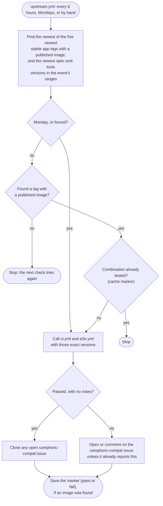

# Testing the event repositories against new releases

This note is for maintainers. It answers [#856](https://github.com/camphoric/camphoric/issues/856):
when Camphoric or one of its import packages is released, how does each camp's event repository
get tested against the new version, instead of waiting up to a week for its weekly run? It is a
recommendation; the work to carry it out is tracked in
[#917](https://github.com/camphoric/camphoric/issues/917) and carried out in each event repository
by pull requests camphoric/camphoric-event-lark#5, -harmony#3, -familyweek#4 and -ltacampout#4,
whose workflow files are identical. Once that lands, the outcome belongs in
[RELEASE.md](../RELEASE.md) ("Event repositories"), and this note keeps the reasoning. It
supersedes the first recommendation, posted as a comment on #856, where they differ: the packages
are now on npm rather than GitHub Packages, the app's tag is picked by version rather than by
"Latest", the packages' versions are sorted by semver, and the check tests the newest release whose
image is published (section 4).

**In short:** each event repository checks for new releases itself. A scheduled workflow in each
one, `upstream.yml`, runs every 6 hours. It finds the newest stable Camphoric release whose image
is published (one of the five newest), and the newest import-spec and import-tools versions within
the event's ranges. When it hasn't tested that combination yet, it runs the repository's own
`ci.yml` and `e2e.yml` against exactly those versions, and opens or updates a `camphoric-compat`
issue in that repository when they fail. It needs no GitHub App, no PAT and no secrets, and Camphoric's release workflows don't
change. A pre-release is checked on demand, by dispatching the event repositories' e2e runs with a
maintainer's own `gh` login.

## 1. Where things stand

| Release | What it publishes | What tests an event repository against it today |
| --- | --- | --- |
| The app, `vX.Y.Z` (`release-please.yml`) | the image `ghcr.io/camphoric/camphoric:vX.Y.Z`, and `latest` | `e2e.yml` in each event repository, against `latest`: on pull requests, on Mondays at 14:00 UTC, and by hand (`workflow_dispatch` with an `image_tag` input) |
| A pre-release, `vX.Y.Z-<pre>.N` (`prerelease.yml`) | the image at that tag (never `latest`) | nothing, unless someone runs `e2e.yml` by hand with that `image_tag` |
| `@camphoric/camphoric-event-import-spec` or `-tools` (`release-packages.yml`) | the package on npm | nothing until the event repository's lockfile moves: `ci.yml` (on pushes to `main` and pull requests) and `e2e.yml` install the lockfile's versions with `npm ci` |

So a release that breaks an event's registration form can go unnoticed for up to a week, and a new
package version within an event's caret range (`^1.0.0`) isn't tested in that repository at all
until somebody changes it. In this repository, `events-latest.yml` covers the other direction
weekly: the newest published *events* against Camphoric's `main`.

The four event repositories (lark, harmony, familyweek, ltacampout) have identical `ci.yml`,
`e2e.yml` and `release-please.yml`, so one design fits all of them.

## 2. Mechanism: the event repositories check on a schedule

GitHub has no cross-repository trigger. An event repository can't run "when camphoric/camphoric
publishes a release" or "when a package is published": those events fire only in
camphoric/camphoric. That leaves two ways to start an event repository's run.

| | Camphoric dispatches after a release | Each event repository checks on a schedule |
| --- | --- | --- |
| How | a job after `build-image` (and after `publish-spec` / `publish-tools`) calls each event repository's `workflow_dispatch` (or `repository_dispatch`) API | a cron workflow in each event repository looks up the newest versions and tests the ones it hasn't tested |
| Credentials | `GITHUB_TOKEN` can't dispatch to another repository, so a GitHub App (or a PAT) with `Actions: write` on every event repository, its private key in a secret, and an installation to extend for each new event repository | each repository's own `GITHUB_TOKEN`; Camphoric's releases, its image and the npm packages are all public |
| Delay after a release | minutes | up to 6 hours |
| Knowing the event repositories | camphoric/camphoric keeps or discovers the list | nothing to keep: each repository tests what it depends on |
| A failed dispatch | can fail the release run, or has to be made non-fatal | a delayed or dropped cron run is retried by the next one |

**The scheduled check wins.** Neither approach blocks a release, because the release is published
before either runs, so the faster approach only reports a breakage sooner: within minutes rather
than within hours, against up to a week today. In exchange the scheduled check has no credentials
to create, rotate or extend, no repository list, and no new way for a release run to fail. It also
follows the dependency direction, the way Dependabot does: each event repository tests what it
depends on, and camphoric/camphoric doesn't need to know who depends on it.

Of the two dispatch endpoints, `workflow_dispatch` would be the one to use if that's ever revisited:
`e2e.yml` already accepts `image_tag`, and it needs only `Actions: write`, where
`repository_dispatch` needs `Contents: write` and a new trigger in every event repository. Its
credential would be a GitHub App minted per run with `actions/create-github-app-token`
(`owner: camphoric`, `repositories:` the event repositories), with the App's private key in an org
secret visible only to camphoric/camphoric, and the dispatch job skipped when the secret isn't set.

## 3. Auth: each event repository's own `GITHUB_TOKEN`

- **The newest app release:** `gh api repos/camphoric/camphoric/releases` reads a public repository,
  which the default token can do.
- **The image:** `docker manifest inspect ghcr.io/camphoric/camphoric:<tag>` works without signing
  in, because the image is public (the e2e runs already pull it anonymously).
- **The packages:** `npm view` on npmjs.com needs no token.
- **The report:** opening or commenting on an issue needs `issues: write`, granted only to the job
  that reports.

There are no secrets to store and no setup outside the workflow files.

## 4. Which versions get tested: exact versions, passed as inputs

A run that installs the lockfile's versions proves nothing about a new release, so the check finds
exact versions and passes them to `ci.yml` and `e2e.yml` as inputs.

- **The app:** the newest stable release tag, picked by version from the repository's releases:
  tags matching `vX.Y.Z` with no pre-release suffix, sorted with `sort -V`. Not
  `gh release view`'s "Latest": a package release is briefly Latest, until `release-packages.yml`
  marks the app's release as Latest again, and the releases API doesn't list releases strictly by
  version either.
- **The newest release whose image is published.** The release is created before `build-image`
  pushes the image, so the check tries the five newest stable tags, newest first, with
  `docker manifest inspect`, and tests the first whose image is published. When that isn't the
  newest release, the run adds the note "Camphoric `vX` is released, but
  ghcr.io/camphoric/camphoric:vX isn't published yet: this run tests `vY`, the newest release
  whose image is." So a new package version is still tested within 6 hours while an image is late,
  and the newer tag is tested once its image appears (the marker names the tag tested, section 5).
  A note makes a report not clean (section 8), so a check that lands between a joint release's
  tools publish and its image push opens the issue, and the next check, finding the image, closes
  it.
- **An image that never gets published** (a failed `build-image` nobody re-ran) is reported by
  that note, on every run that tests, until someone publishes the image; the older tag keeps
  passing. Only when none of the five newest tags has an image does a 6-hourly check stop without
  testing (and without recording the combination); the Monday run and a forced run then test the
  newest release anyway, so e2e fails and the issue reports it rather than every check stopping
  silently.
- **The packages:** the highest published version within the range in the event's `package.json`,
  for both the spec and the tools: the package's `versions`, filtered and sorted by the `semver`
  CLI. Not the last entry of `npm view "<package>@<range>" version`, which is in publish order: a
  republished older version (which `release-packages.yml` allows for) would come last. The check
  also finds each package's newest stable version in any range (`semver -r '*'`, which leaves out
  pre-releases), for the note about a newer version outside the range below.
- **A lookup that fails fails the check.** The version step runs with `set -euo pipefail` and
  fails when any version comes back empty (a GitHub or npm outage, say), so the run shows red
  rather than skipping silently. Bash turns `set -e` off inside a function called through `$(…)`,
  so the lookup functions pass their failures on explicitly (`|| return`). The image lookup is the
  exception: `docker manifest inspect` can't tell a missing image from a GHCR error, so an error
  reads as "not published yet" (an older tag and the note above, or, for all five, a stopped
  6-hourly check until the Monday run).
- **Pinning them:** `ci.yml` and `e2e.yml` gain `spec_version` and `tools_version` inputs (and
  `e2e.yml` keeps `image_tag`). After `npm ci`, a step installs exactly those versions with
  `npm install --no-save`, checks each installed package's own `package.json` version against the
  one asked for, and lists the two packages in the step summary. Pushes and pull requests leave the
  inputs empty and keep using the lockfile. `ci.yml` also passes `spec_version` to
  `scripts/smoke-test-package.sh` (as `SPEC_VERSION`), whose fresh project otherwise installs the
  newest spec in the peer range.
- **Exact versions, in the event's range or not.** Run by hand, the inputs also take a version
  outside the range (a new major, or a pre-release such as `1.3.0-rc.1`), to try one before
  migrating. When npm refuses it over a peer range, the step installs it again with `--force` and
  warns. `npm ls` would fail on such a version, so the step checks the installed version itself
  (accepting npm's `=1.2.1` and `v1.2.1` spellings) and shows `npm ls` only in the summary. Ranges
  and dist-tags aren't accepted.
- **Other packages can move too.** A tools version's peer range can raise `@playwright/test`, and
  with it the Chromium the e2e tests use: tools 1.2.1 needs `^1.64.1`, and the lark, harmony and
  familyweek lockfiles have 1.63.0 (ltacampout's already has 1.64.1). So in those three, every
  scheduled run, which always pins tools, moves `@playwright/test` off the lockfile's version. The
  step summary lists only the two Camphoric packages; the install log shows what else moved.
- **Any new version runs both workflows.** The e2e harness (`defineEventE2EConfig`, `e2eServer`)
  ships in import-tools, so a tools release can break the e2e tests as well as CI, and `ci.yml` is
  cheap.
- **A newer version outside the event's range** (a new major, or 1.1.0 against `~1.0.0`) isn't
  tested by the scheduled check. It appears as a note in the `camphoric-compat` issue ("`<package>`
  X is published, outside this event's range (`<range>`): this event needs migrating to it."), as
  `latest-events-notes.sh` reports events here. The marker's key includes each package's newest
  version, so such a release starts a run, and its note, within 6 hours (section 5).

## 5. "Already tested": a marker in the Actions cache

Each run that tests a combination saves an empty cache entry named for it, such as
`camphoric-tested-v0.14.0-spec-1.0.1-tools-1.2.1-newest-spec-1.0.1-tools-1.2.1`: the image tag
tested, the spec and tools versions tested, and each package's newest version in any range (so a
new major changes the key, and the run reports its note). The next check looks the key up with
`actions/cache/restore` and `lookup-only: true`, and stops when it exists. Scheduled runs may write
caches, because they run on the default branch.

- **Saved pass or fail, after the report.** A failing combination isn't retried every 6 hours: the
  issue already tracks it. The marker is saved after the issue is updated, so a report that fails
  is retried by the next check, and only when an image was found: a Monday or forced run against
  a missing image records nothing, so the combination is tested once the image appears.
- **A weekly run tests regardless.** A second cron entry, Mondays at 14:00 UTC, always tests. It
  replaces the weekly schedule in `e2e.yml` (and gives `ci.yml` a weekly run too), catches drift no
  release causes (a new Node 22 release, a new runner image, new in-range dependencies the smoke
  test installs from npm, and a new `@playwright/test`, and so Chromium, within the tools peer
  range; section 4), and closes the issue once things pass
  again. Saving a key that already exists, on that run or a forced one, logs a warning rather than
  failing, and doesn't refresh the entry.
- **The marker may expire.** GitHub evicts a cache entry that hasn't been used for 7 days, and its
  docs don't say whether a `lookup-only` lookup counts as using it. So an old combination may be
  tested again about a week after it was first tested. That costs a run, not noise: the issue's
  fingerprint skips a report it already has.
- **Re-checking after a fix.** A fix pushed to the event repository runs `ci.yml` against the
  lockfile, not the new versions, and the marker stops the 6-hourly check from retrying the failed
  combination. To confirm the fix (and close the issue) before Monday, run `upstream.yml` by hand
  with `force`.



## 6. Repository list: none needed

Each event repository checks for itself, so nothing lists them for this purpose. A new event
repository starts from copies of an existing one's `.github/workflows/` (RELEASE.md, "Adding a
camp's event"), so it has `upstream.yml` from its first commit. The four copies stay identical, as
`ci.yml` and `e2e.yml` are today; if the shell in `upstream.yml` grows, it can move into
import-tools, which already ships the shared e2e harness.

camphoric/camphoric already discovers the org's `camphoric-event-*` repositories in
`latest-events-notes.sh` (for `events-latest.yml`'s notes). That script also notes an event
repository whose `upstream.yml` is missing or not `active` (see "Caveats").

## 7. Pre-releases: on demand

The scheduled check looks only at the newest stable release. A pre-release is for checking a change
before it ships, so it runs when a maintainer asks rather than on a timer. `e2e.yml` keeps its
`workflow_dispatch` input, so once `prerelease.yml` has pushed the image:

```bash
for event in lark harmony familyweek ltacampout; do
  gh workflow run e2e.yml -R "camphoric/camphoric-event-$event" -f image_tag=v0.15.0-rc.1
done
```

This uses the maintainer's own `gh` login, so it needs no App either. A small script in this
repository, `data/scripts/test-event-repos.sh <image-tag>`, does the same for every
`camphoric-event-*` repository it finds and prints each run's link. The packages have no
pre-release flow.

## 8. Reporting: an issue in the event repository

- **The event repository's Actions tab** has the "Camphoric releases" run, with the called CI and
  E2E jobs, the tested versions in the step summary, and the Playwright report artifact.
- **A `camphoric-compat` issue in the event repository**, kept the way `events-latest.yml` keeps its
  `event-compat` issue here: a failure or a note opens the issue or comments on it (naming the
  versions tested), a report the issue already has isn't repeated (a fingerprint in a hidden
  comment), and a clean run closes it. Watching the event repositories delivers these
  notifications.

There's no single "vX.Y.Z passed for every event" view; the org-wide search
`is:open label:camphoric-compat org:camphoric` serves as one. Reporting back into Camphoric's
release run would need the dispatch approach and a way to wait for the event runs, which section 2
rules out.

## 9. The reverse direction: before a release ships

The pre-release dispatch above already runs every event's e2e tests against an image before it
ships, whenever a maintainer cuts a pre-release. `docker.yml` also imports every event into an
image built from `main` on each push, but it doesn't run the event repositories' own Playwright
specs, which aren't in their published packages. If cutting a pre-release turns out to be too much
friction, the next step is for `docker.yml` to push a `main` image tag on pushes to `main` and for
`upstream.yml` to test that tag too, reporting it separately from stable releases. That waits until
the scheduled check has run for a while.

## 10. Caveats

- **Scheduled workflows stop after 60 days without activity.** In a public repository, GitHub
  disables them after 60 days with no repository activity, and an event repository can go quiet
  between camp seasons (today's weekly e2e run has the same problem). `latest-events-notes.sh`
  notes a disabled `upstream.yml` (`gh api repos/camphoric/<repo>/actions/workflows/upstream.yml
  --jq .state` is `disabled_inactivity`), and re-enabling it is one click in that repository's
  Actions tab.
- **Scheduled runs can be delayed or dropped** under load, most at the top of the hour, so the cron
  uses an odd minute (`23 */6 * * *`).
- **Concurrency in the called workflows.** When `upstream.yml` calls `ci.yml` and `e2e.yml`,
  `github.workflow` inside them is the caller's name, so their current group
  (`${{ github.workflow }}-${{ github.ref }}`) resolves to `Camphoric releases-refs/heads/main` in
  both: `ci` and `e2e` would wait for each other instead of running side by side. Their group needs
  a literal prefix. Pull requests share one per branch (so a new push cancels a superseded run), and
  in `ci.yml` so do pushes (so pushes to `main` still queue, as before); every other run, including
  each one `upstream.yml` calls, gets its own:

  ```yaml
  # e2e.yml (it has no push trigger)
  concurrency:
    group: e2e-${{ github.event_name == 'pull_request' && github.ref || github.run_id }}
    cancel-in-progress: ${{ github.event_name == 'pull_request' }}

  # ci.yml
  concurrency:
    group: ci-${{ (github.event_name == 'push' || github.event_name == 'pull_request') && github.ref || github.run_id }}
    cancel-in-progress: ${{ github.event_name == 'pull_request' }}
  ```

## 11. The workflows in each event repository

The workflows are added by [camphoric-event-lark#5](https://github.com/camphoric/camphoric-event-lark/pull/5)
(once merged, in lark's `.github/workflows/`), and the other three event repositories' pull
requests add byte-identical copies. That code is the reference; this outline doesn't repeat it.
`scripts/smoke-test-package.sh` is the exception: each repository keeps its own, which differ
slightly (ltacampout always checks for `reports/`), so a change to it is applied to each copy, not
copied from lark.

- **`upstream.yml` ("Camphoric releases")** runs at `23 */6 * * *` and `0 14 * * 1`, and by hand
  (`workflow_dispatch`, with a `force` input). It runs one at a time (`concurrency: upstream`),
  and has four jobs:
  - `detect` finds the versions (section 4), writes them and any notes to the step summary, builds
    the marker's key, and looks it up with `lookup-only` (section 5). Its `test` output is true on
    the Monday run or a forced one, and otherwise when an image was found and the marker missed.
  - `ci` and `e2e` call `./.github/workflows/ci.yml` and `./.github/workflows/e2e.yml` with
    `image_tag`, `spec_version` and `tools_version`.
  - `record` (`issues: write`, unless cancelled) opens, comments on or closes the
    `camphoric-compat` issue from the CI and E2E results and the notes, with the fingerprint
    pattern from this repository's `events-latest.yml`, then saves the marker.
- **`ci.yml` and `e2e.yml`** gain a `workflow_call` trigger with `spec_version` and `tools_version`
  string inputs (`e2e.yml` also `image_tag`), the same inputs under `workflow_dispatch` (new for
  `ci.yml`), the "Use the requested Camphoric package versions" step after `npm ci` (section 4),
  and the concurrency groups in section 10. `e2e.yml` drops its `schedule`, which `upstream.yml`'s
  Monday run replaces. Its `CAMPHORIC_IMAGE_TAG: ${{ inputs.image_tag || 'latest' }}` already
  works for all three triggers.
- **`scripts/smoke-test-package.sh`** installs the requested spec version (`SPEC_VERSION`) beside
  the packed package, when one is given.

## 12. Changes in this repository

Camphoric's release workflows don't change. Two small additions, once the event repositories have
`upstream.yml`:

- **`data/scripts/latest-events-notes.sh`** notes an event repository whose `upstream.yml` is missing
  or not `active`. The workflow's state is public, so the default token can read it. (Adding this
  note earlier would flag every event repository each week until they have the workflow.)
- **`data/scripts/test-event-repos.sh <image-tag>`** runs every event repository's `e2e.yml`
  against a pre-release tag and prints each run's link.

[RELEASE.md](../RELEASE.md) then says that the event repositories test a new release within about
6 hours, how to check a pre-release, and where failures show up.

## 13. Rollout

1. **One event repository first:** add `upstream.yml` and the `ci.yml` / `e2e.yml` changes, run
   `upstream.yml` by hand with `force`, then again without it to see the marker skip the run.
   `workflow_dispatch` needs the workflow on the default branch, so this follows the merge.
2. **The other three:** copy the same workflow files, and make the same change to each
   repository's own `scripts/smoke-test-package.sh`.
3. **This repository:** the `latest-events-notes.sh` note, `test-event-repos.sh`, and RELEASE.md.
