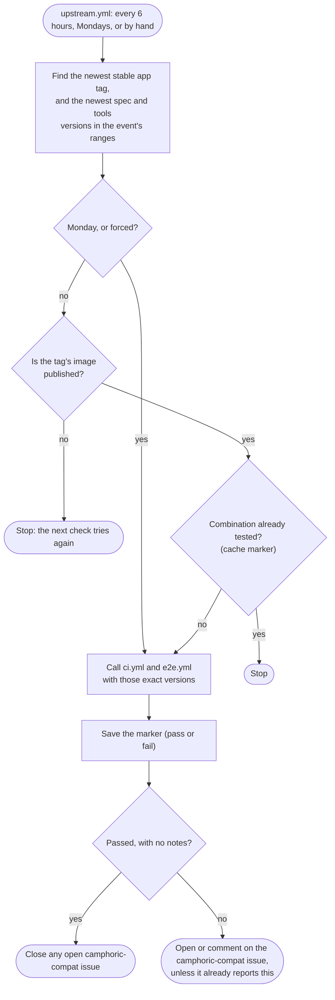

# Testing the event repositories against new releases

This note is for maintainers. It answers [#856](https://github.com/camphoric/camphoric/issues/856):
when Camphoric or one of its import packages is released, how does each camp's event repository
get tested against the new version, instead of waiting up to a week for its weekly run? It is a
recommendation; the work to carry it out is tracked in
[#917](https://github.com/camphoric/camphoric/issues/917). Once that lands, the outcome belongs in
[RELEASE.md](../RELEASE.md) ("Event repositories"), and this note keeps the reasoning. It
supersedes the first recommendation, posted as a comment on #856, and #917's checklist where they
differ: the packages are now on npm rather than GitHub Packages, the app's tag is picked by version
rather than by "Latest", the packages' versions are sorted by semver, and the check waits for the
release's image (section 4).

**In short:** each event repository checks for new releases itself. A scheduled workflow in each
one, `upstream.yml`, runs every 6 hours. It finds the newest stable Camphoric release whose image
is published, and the newest import-spec and import-tools versions within the event's ranges. When
it hasn't tested that combination yet, it runs the repository's own `ci.yml` and `e2e.yml` against
exactly those versions, and opens or updates a `camphoric-compat` issue in that repository when
they fail. It needs no GitHub App, no PAT and no secrets, and Camphoric's release workflows don't
change. A pre-release is checked on demand, by dispatching the event repositories' e2e runs with a
maintainer's own `gh` login.

## 1. Where things stand

| Release | What it publishes | What tests an event repository against it today |
| --- | --- | --- |
| The app, `vX.Y.Z` (`release-please.yml`) | the image `ghcr.io/camphoric/camphoric:vX.Y.Z`, and `latest` | `e2e.yml` in each event repository, against `latest`: on pull requests, on Mondays at 14:00 UTC, and by hand (`workflow_dispatch` with an `image_tag` input) |
| A pre-release, `vX.Y.Z-<pre>.N` (`prerelease.yml`) | the image at that tag (never `latest`) | nothing, unless someone runs `e2e.yml` by hand with that `image_tag` |
| `@camphoric/camphoric-event-import-spec` or `-tools` (`release-packages.yml`) | the package on npm | nothing until the event repository's lockfile moves: `ci.yml` (on pushes to `main` and pull requests) and `e2e.yml` install the lockfile's versions with `npm ci` |

So a release that breaks an event's registration form can go unnoticed for up to a week, and a new
package version within an event's caret range (`^1.0.0`) isn't tested in that repository at all
until somebody changes it. In this repository, `events-latest.yml` covers the other direction
weekly: the newest published *events* against Camphoric's `main`.

The four event repositories (lark, harmony, familyweek, ltacampout) have identical `ci.yml`,
`e2e.yml` and `release-please.yml`, so one design fits all of them.

## 2. Mechanism: the event repositories check on a schedule

GitHub has no cross-repository trigger. An event repository can't run "when camphoric/camphoric
publishes a release" or "when a package is published": those events fire only in
camphoric/camphoric. That leaves two ways to start an event repository's run.

| | Camphoric dispatches after a release | Each event repository checks on a schedule |
| --- | --- | --- |
| How | a job after `build-image` (and after `publish-spec` / `publish-tools`) calls each event repository's `workflow_dispatch` (or `repository_dispatch`) API | a cron workflow in each event repository looks up the newest versions and tests the ones it hasn't tested |
| Credentials | `GITHUB_TOKEN` can't dispatch to another repository, so a GitHub App (or a PAT) with `Actions: write` on every event repository, its private key in a secret, and an installation to extend for each new event repository | each repository's own `GITHUB_TOKEN`; Camphoric's releases, its image and the npm packages are all public |
| Delay after a release | minutes | up to 6 hours |
| Knowing the event repositories | camphoric/camphoric keeps or discovers the list | nothing to keep: each repository tests what it depends on |
| A failed dispatch | can fail the release run, or has to be made non-fatal | a delayed or dropped cron run is retried by the next one |

**The scheduled check wins.** Neither approach blocks a release, because the release is published
before either runs, so the faster approach only reports a breakage sooner: within minutes rather
than within hours, against up to a week today. In exchange the scheduled check has no credentials
to create, rotate or extend, no repository list, and no new way for a release run to fail. It also
follows the dependency direction, the way Dependabot does: each event repository tests what it
depends on, and camphoric/camphoric doesn't need to know who depends on it.

Of the two dispatch endpoints, `workflow_dispatch` would be the one to use if that's ever revisited:
`e2e.yml` already accepts `image_tag`, and it needs only `Actions: write`, where
`repository_dispatch` needs `Contents: write` and a new trigger in every event repository. Its
credential would be a GitHub App minted per run with `actions/create-github-app-token`
(`owner: camphoric`, `repositories:` the event repositories), with the App's private key in an org
secret visible only to camphoric/camphoric, and the dispatch job skipped when the secret isn't set.

## 3. Auth: each event repository's own `GITHUB_TOKEN`

- **The newest app release:** `gh api repos/camphoric/camphoric/releases` reads a public repository,
  which the default token can do.
- **The image:** `docker manifest inspect ghcr.io/camphoric/camphoric:<tag>` works without signing
  in, because the image is public (the e2e runs already pull it anonymously).
- **The packages:** `npm view` on npmjs.com needs no token.
- **The report:** opening or commenting on an issue needs `issues: write`, granted only to the job
  that reports.

There are no secrets to store and no setup outside the workflow files.

## 4. Which versions get tested: exact versions, passed as inputs

A run that installs the lockfile's versions proves nothing about a new release, so the check finds
exact versions and passes them to `ci.yml` and `e2e.yml` as inputs.

- **The app:** the newest stable release tag, picked by version from the repository's releases:
  tags matching `vX.Y.Z` with no pre-release suffix, sorted with `sort -V`. Not
  `gh release view`'s "Latest": a package release is briefly Latest, until `release-packages.yml`
  marks the app's release as Latest again, and the releases API doesn't list releases strictly by
  version either.
- **Only once its image is published.** The release is created before `build-image` pushes the
  image, so a check in that window would find a tag with no image and record a false failure. When
  `docker manifest inspect` doesn't find the image, a 6-hourly check stops without testing (and
  without recording the combination), and the next check picks it up. The Monday run and a forced
  run test anyway, so an image that never got published (a failed `build-image` nobody re-ran)
  fails e2e and is reported in the issue instead of silently stopping every check.
- **The packages:** the highest published version within the range in the event's `package.json`,
  for both the spec and the tools: the package's `versions`, filtered and sorted by the `semver`
  CLI. Not the last entry of `npm view "<package>@<range>" version`, which is in publish order: a
  republished older version (which `release-packages.yml` allows for) would come last.
- **A lookup that fails fails the check.** The version step runs with `set -euo pipefail` and
  fails when any version comes back empty (a GitHub or npm outage, say), so the run shows red
  rather than skipping silently. GitHub emails a failed scheduled run to whoever last changed its
  cron.
- **Pinning them:** `ci.yml` and `e2e.yml` gain `spec_version` and `tools_version` inputs (and
  `e2e.yml` keeps `image_tag`). After `npm ci`, a step installs exactly those versions with
  `npm install --no-save`, fails unless `npm ls` shows them, and writes the tree to the step
  summary. Pushes and pull requests leave the inputs empty and keep using the lockfile.
  `scripts/smoke-test-package.sh` installs the spec peer from npm by range, so it already gets the
  newest version.
- **Any new version runs both workflows.** The e2e harness (`defineEventE2EConfig`, `e2eServer`)
  ships in import-tools, so a tools release can break the e2e tests as well as CI, and `ci.yml` is
  cheap.
- **A new major outside the event's range** isn't tested. It appears as a note in the
  `camphoric-compat` issue ("a new major is published; this event needs migrating"), as
  `latest-events-notes.sh` reports events here.

The step `ci.yml` and `e2e.yml` each get, after `npm ci`:

```yaml
      - name: Use the requested Camphoric package versions
        if: ${{ inputs.spec_version || inputs.tools_version }}
        env:
          SPEC: ${{ inputs.spec_version }}
          TOOLS: ${{ inputs.tools_version }}
        run: |
          packages=()
          if [ -n "$SPEC" ]; then packages+=("@camphoric/camphoric-event-import-spec@$SPEC"); fi
          if [ -n "$TOOLS" ]; then packages+=("@camphoric/camphoric-event-import-tools@$TOOLS"); fi
          npm install --no-save "${packages[@]}"
          npm ls "${packages[@]}"   # fails unless exactly these versions are installed
          {
            echo '```'
            npm ls @camphoric/camphoric-event-import-spec @camphoric/camphoric-event-import-tools
            echo '```'
          } >> "$GITHUB_STEP_SUMMARY"
```

## 5. "Already tested": a marker in the Actions cache

Each run that tests a combination saves an empty cache entry named for it, such as
`camphoric-tested-v0.14.0-spec-1.0.1-tools-1.2.1`. The next check looks the key up with
`actions/cache/restore` and `lookup-only: true`, and stops when it exists. Scheduled runs may write
caches, because they run on the default branch.

- **Saved pass or fail.** A failing combination isn't retried every 6 hours: the issue already
  tracks it.
- **A weekly run tests regardless.** A second cron entry, Mondays at 14:00 UTC, always tests. It
  replaces the weekly schedule in `e2e.yml` (and gives `ci.yml` a weekly run too), catches drift no
  release causes (Chrome, base images, the npm registry), and closes the issue once things pass
  again. Saving a key that already exists, on that run or a forced one, logs a warning rather than
  failing, and doesn't refresh the entry.
- **The marker may expire.** GitHub evicts a cache entry that hasn't been used for 7 days, and its
  docs don't say whether a `lookup-only` lookup counts as using it. So an old combination may be
  tested again about a week after it was first tested. That costs a run, not noise: the issue's
  fingerprint skips a report it already has.
- **Re-checking after a fix.** A fix pushed to the event repository runs `ci.yml` against the
  lockfile, not the new versions, and the marker stops the 6-hourly check from retrying the failed
  combination. To confirm the fix (and close the issue) before Monday, run `upstream.yml` by hand
  with `force`.



## 6. Repository list: none needed

Each event repository checks for itself, so nothing lists them for this purpose. A new event
repository starts from copies of an existing one's `.github/workflows/` (RELEASE.md, "Adding a
camp's event"), so it has `upstream.yml` from its first commit. The four copies stay identical, as
`ci.yml` and `e2e.yml` are today; if the shell in `upstream.yml` grows, it can move into
import-tools, which already ships the shared e2e harness.

camphoric/camphoric already discovers the org's `camphoric-event-*` repositories in
`latest-events-notes.sh` (for `events-latest.yml`'s notes). That script also notes an event
repository whose `upstream.yml` is missing or not `active` (see "Caveats").

## 7. Pre-releases: on demand

The scheduled check looks only at the newest stable release. A pre-release is for checking a change
before it ships, so it runs when a maintainer asks rather than on a timer. `e2e.yml` keeps its
`workflow_dispatch` input, so once `prerelease.yml` has pushed the image:

```bash
for event in lark harmony familyweek ltacampout; do
  gh workflow run e2e.yml -R "camphoric/camphoric-event-$event" -f image_tag=v0.15.0-rc.1
done
```

This uses the maintainer's own `gh` login, so it needs no App either. A small script in this
repository, `data/scripts/test-event-repos.sh <image-tag>`, does the same for every
`camphoric-event-*` repository it finds and prints each run's link. The packages have no
pre-release flow.

## 8. Reporting: an issue in the event repository

- **The event repository's Actions tab** has the "Camphoric releases" run, with the called CI and
  E2E jobs, the tested versions in the step summary, and the Playwright report artifact.
- **A `camphoric-compat` issue in the event repository**, kept the way `events-latest.yml` keeps its
  `event-compat` issue here: a failure or a note opens the issue or comments on it (naming the
  versions tested), a report the issue already has isn't repeated (a fingerprint in a hidden
  comment), and a clean run closes it. Watching the event repositories delivers these
  notifications.

There's no single "vX.Y.Z passed for every event" view; the org-wide search
`is:open label:camphoric-compat org:camphoric` serves as one. Reporting back into Camphoric's
release run would need the dispatch approach and a way to wait for the event runs, which section 2
rules out.

## 9. The reverse direction: before a release ships

The pre-release dispatch above already runs every event's e2e tests against an image before it
ships, whenever a maintainer cuts a pre-release. `docker.yml` also imports every event into an
image built from `main` on each push, but it doesn't run the event repositories' own Playwright
specs, which aren't in their published packages. If cutting a pre-release turns out to be too much
friction, the next step is for `docker.yml` to push a `main` image tag on pushes to `main` and for
`upstream.yml` to test that tag too, reporting it separately from stable releases. That waits until
the scheduled check has run for a while.

## 10. Caveats

- **Scheduled workflows stop after 60 days without activity.** In a public repository, GitHub
  disables them after 60 days with no repository activity, and an event repository can go quiet
  between camp seasons (today's weekly e2e run has the same problem). `latest-events-notes.sh`
  notes a disabled `upstream.yml` (`gh api repos/camphoric/<repo>/actions/workflows/upstream.yml
  --jq .state` is `disabled_inactivity`), and re-enabling it is one click in that repository's
  Actions tab.
- **Scheduled runs can be delayed or dropped** under load, most at the top of the hour, so the cron
  uses an odd minute (`23 */6 * * *`).
- **Concurrency in the called workflows.** When `upstream.yml` calls `ci.yml` and `e2e.yml`,
  `github.workflow` inside them is the caller's name, so their current group
  (`${{ github.workflow }}-${{ github.ref }}`) resolves to `Camphoric releases-refs/heads/main` in
  both: `ci` and `e2e` would wait for each other instead of running side by side. Their group needs
  a literal prefix. Only pull requests need to share one (so a new push cancels a superseded run);
  every other run gets its own:

  ```yaml
  concurrency:
    group: e2e-${{ github.event_name == 'pull_request' && github.ref || github.run_id }}
    cancel-in-progress: ${{ github.event_name == 'pull_request' }}
  ```

## 11. Sketch: each event repository

A new `.github/workflows/upstream.yml`:

```yaml
# Test this event against the newest Camphoric release (once its image is
# published) and the newest import-spec / import-tools versions in its ranges,
# once per new combination and weekly regardless, and report in a
# camphoric-compat issue.
name: Camphoric releases

on:
  schedule:
    - cron: '23 */6 * * *'  # look for new versions
    - cron: '0 14 * * 1'    # weekly: test even if nothing changed
  workflow_dispatch:
    inputs:
      force:
        description: Test even if these versions were tested already
        type: boolean
        default: false

concurrency:
  group: upstream
  cancel-in-progress: false

permissions:
  contents: read

jobs:
  detect:
    runs-on: ubuntu-latest
    env:
      GH_TOKEN: ${{ secrets.GITHUB_TOKEN }}
    outputs:
      image_tag: ${{ steps.versions.outputs.image_tag }}
      spec_version: ${{ steps.versions.outputs.spec_version }}
      tools_version: ${{ steps.versions.outputs.tools_version }}
      key: ${{ steps.versions.outputs.key }}
      # Monday and forced runs always test (a missing image then fails e2e and
      # is reported); a 6-hourly one waits for the image and skips a tested
      # combination.
      test: >-
        ${{ github.event.schedule == '0 14 * * 1' || inputs.force
        || (steps.versions.outputs.image_ready == 'true' && steps.tested.outputs.cache-hit != 'true') }}
    steps:
      - uses: actions/checkout@v7
      - uses: actions/setup-node@v7
        with:
          node-version: 22

      - id: versions
        shell: bash
        run: |
          set -euo pipefail
          # The highest published version of $1 within this event's range for
          # it (npm lists versions in publish order, so sort them by semver)
          newest() {
            range=$(node -p "require('./package.json').devDependencies['$1']")
            npm view "$1" versions --json \
              | jq -r 'if type == "array" then .[] else . end' \
              | xargs npx --yes semver@7 -r "$range" \
              | tail -n 1
          }
          image=$(gh api --paginate repos/camphoric/camphoric/releases \
            --jq '.[] | select((.prerelease or .draft) | not) | .tag_name' \
            | grep -E '^v[0-9]+\.[0-9]+\.[0-9]+$' | sort -V | tail -n 1)
          spec=$(newest @camphoric/camphoric-event-import-spec)
          tools=$(newest @camphoric/camphoric-event-import-tools)
          if [ -z "$image" ] || [ -z "$spec" ] || [ -z "$tools" ]; then
            echo "couldn't find the versions to test (image '$image', spec '$spec', tools '$tools')" >&2
            exit 1
          fi
          if docker manifest inspect "ghcr.io/camphoric/camphoric:$image" > /dev/null 2>&1; then
            ready=true
          else
            ready=false
            echo "ghcr.io/camphoric/camphoric:$image isn't published yet" >> "$GITHUB_STEP_SUMMARY"
          fi
          {
            echo "image_tag=$image"
            echo "image_ready=$ready"
            echo "spec_version=$spec"
            echo "tools_version=$tools"
            echo "key=camphoric-tested-$image-spec-$spec-tools-$tools"
          } >> "$GITHUB_OUTPUT"

      - id: tested
        uses: actions/cache/restore@v6
        with:
          path: .camphoric-tested
          key: ${{ steps.versions.outputs.key }}
          lookup-only: true

  ci:
    needs: detect
    if: ${{ needs.detect.outputs.test == 'true' }}
    uses: ./.github/workflows/ci.yml
    with:
      spec_version: ${{ needs.detect.outputs.spec_version }}
      tools_version: ${{ needs.detect.outputs.tools_version }}

  e2e:
    needs: detect
    if: ${{ needs.detect.outputs.test == 'true' }}
    uses: ./.github/workflows/e2e.yml
    with:
      image_tag: ${{ needs.detect.outputs.image_tag }}
      spec_version: ${{ needs.detect.outputs.spec_version }}
      tools_version: ${{ needs.detect.outputs.tools_version }}

  record:
    needs: [detect, ci, e2e]
    if: ${{ !cancelled() && needs.detect.outputs.test == 'true' }}
    runs-on: ubuntu-latest
    permissions:
      issues: write
    steps:
      # Pass or fail: a failure is tracked by the issue, not retried every 6 hours
      - run: touch .camphoric-tested
      - uses: actions/cache/save@v6
        with:
          path: .camphoric-tested
          key: ${{ needs.detect.outputs.key }}
      # Open / comment on / close the camphoric-compat issue from
      # needs.ci.result and needs.e2e.result (plus a note for a package major
      # outside the range), with the fingerprint pattern from camphoric's
      # events-latest.yml.
```

And in `ci.yml` and `e2e.yml`:

- A `workflow_call` trigger with `spec_version` and `tools_version` string inputs; `e2e.yml` also
  gets `image_tag`. The same inputs under `workflow_dispatch`, which `ci.yml` gains for the first
  time.
- The "Use the requested Camphoric package versions" step from section 4, after `npm ci`.
- The concurrency group from section 10, with a `ci-` or `e2e-` prefix.
- `e2e.yml` drops its `schedule`, which `upstream.yml`'s Monday run replaces. Its
  `CAMPHORIC_IMAGE_TAG: ${{ inputs.image_tag || 'latest' }}` already works for all three triggers.

## 12. Changes in this repository

Camphoric's release workflows don't change. Two small additions, once the event repositories have
`upstream.yml`:

- **`data/scripts/latest-events-notes.sh`** notes an event repository whose `upstream.yml` is missing
  or not `active`. The workflow's state is public, so the default token can read it. (Adding this
  note earlier would flag every event repository each week until they have the workflow.)
- **`data/scripts/test-event-repos.sh <image-tag>`** runs every event repository's `e2e.yml`
  against a pre-release tag and prints each run's link.

[RELEASE.md](../RELEASE.md) then says that the event repositories test a new release within about
6 hours, how to check a pre-release, and where failures show up.

## 13. Rollout

1. **One event repository first:** add `upstream.yml` and the `ci.yml` / `e2e.yml` changes, run
   `upstream.yml` by hand with `force`, then again without it to see the marker skip the run.
2. **The other three:** copy the same files.
3. **This repository:** the `latest-events-notes.sh` note, `test-event-repos.sh`, and RELEASE.md.
