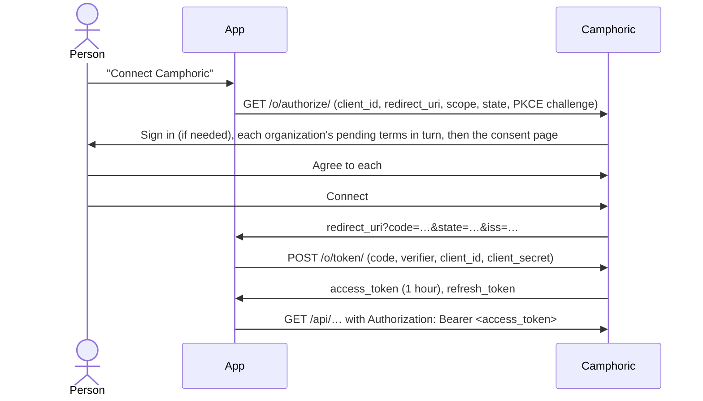

# Apps using Camphoric's API (OAuth 2.0)

Third-party apps — the first is
[lark-camp-admin-tool](https://github.com/larktraditionalarts/lark-camp-admin-tool) — call
Camphoric's API **on behalf of the Camphoric users who approve them**, through OAuth 2.0. The app
never sees anyone's password, can be limited to reading, and its access can be ended for one person
or for everyone at once. The contract is in [SPEC_CLIENT_V2.md](../SPEC_CLIENT_V2.md) §6 and §8.10,
and the reasons in its decision records DR-146 to DR-151.



## Registering the app

An Admin registers it in the Camphoric admin: the user menu › **Apps** › **Register app**.

- **Name** — what people see on the consent page ("Connect Lark admin tool to your Camphoric
  account?").
- **Redirect URIs** — where Camphoric sends the person back, one per line, each matched exactly
  against the `redirect_uri` the app sends (`https://admin.example.org/oauth/callback`). Only
  `https` is accepted, except on a server with `CAMPHORIC_OAUTH_ALLOW_HTTP_REDIRECTS` on (by
  default, one with `DEBUG` on), for an app being developed against `http://localhost`.

Camphoric then shows the app's **client ID** and **client secret**. Copy the secret straight into
the app's configuration: it's stored hashed and never shown again. If it's lost or leaked, choose
**New secret** from the app's menu; the old one stops working at once, and nobody's connection
ends. **Setup details** in the same menu shows everything but the secret again.

For lark-camp-admin-tool, its `.env` holds:

```dotenv
CAMPHORIC_URL=https://register.example.org
CAMPHORIC_CLIENT_ID=…
CAMPHORIC_CLIENT_SECRET=…
CAMPHORIC_REDIRECT_URI=https://admin.example.org/oauth/camphoric/callback
```

## The endpoints

| Endpoint | URL |
| --- | --- |
| Authorization | `{CAMPHORIC_URL}/o/authorize/` |
| Token | `{CAMPHORIC_URL}/o/token/` |
| Revocation (RFC 7009) | `{CAMPHORIC_URL}/o/revoke_token/` |

The trailing slashes are part of the URLs. The app authenticates at the token and revocation
endpoints with its client ID and secret, in the body (`client_secret_post`) or as HTTP Basic.

## The flow

1. **Send the person to the authorization URL**, with `response_type=code`, `client_id`,
   `redirect_uri` (one of those registered), `scope` (below), a random `state`, and PKCE:
   `code_challenge` (the base64url SHA-256 of a random `code_verifier`) and
   `code_challenge_method=S256`. PKCE is required, and only `S256` is accepted.
2. Camphoric asks them to **sign in** if they aren't, then shows the **consent page**: the app's
   name, who they're signed in as (and a way to sign in as someone else), and what the app asks
   for. Someone without a Camphoric permission group, or with a password to change, can't connect
   apps. Before the consent page, they're asked to **agree to the terms** of every organization
   whose latest terms they haven't agreed to yet, one after another (sorted by name, "2 of 3").
   No code is issued until they've agreed to all of them; **declining** signs them out and sends
   them to the redirect URI with `error=access_denied`, as Cancel does.
3. **Connect** sends them to the redirect URI with `code`, the `state` sent (check it), and `iss`,
   the server's address (check it too: RFC 9207). **Cancel** sends `error=access_denied`.
4. **Exchange the code** within a minute, once: `POST /o/token/` with `grant_type=authorization_code`,
   `code`, `redirect_uri`, `code_verifier`, and the client's credentials. The answer is
   `{ access_token, expires_in: 3600, token_type: "Bearer", scope, refresh_token }`.

## Scopes

| Scope | Lets the app |
| --- | --- |
| `read` | Read: every GET, and the POSTs that only read (a report render, a template preview, the recipients preview). |
| `write` | Change things: every other POST, PUT, PATCH and DELETE. |

Ask for `read write` to do both; with no `scope`, the app gets `read`. The app is held to its
scopes **and** to the person's Camphoric permission group as it is now: a Reporter's token can't
change anything, whatever its scopes. A request outside its scopes is refused with
`403 { "code": "insufficient_scope" }`. No app may manage users, apps or connections, change a
password, or agree to or publish an organization's terms: `403 { "code": "app_not_allowed" }`. Everything else
answers as it would to the person. Connecting asks the person to agree to every organization's
terms first, and publishing new terms ends every app's access (below), so an app shouldn't meet
`403 { "code": "contract_agreement_required" }`; if it does (terms published in the moment between
connecting and calling), show the person "Connect Camphoric" again.

## Calling the API

Send `Authorization: Bearer <access_token>`. No session and no CSRF token are needed. The request
acts as the person, and the audit log records them, not the app.

- An access token works for **an hour**. Past that, or once revoked, it's refused with **401**.
- **Refresh** it with `POST /o/token/`, `grant_type=refresh_token`, `refresh_token`, and the
  client's credentials. Each refresh returns a **new refresh token**; store it, replacing the old
  one, before using the new access token.
- **Never use a refresh token twice.** Presenting one already replaced ends every token of that
  approval (the person has to connect the app again). An app that refreshes from more than one
  process — a web request and a cron job, say — must make sure only one refreshes a given
  person's token at a time (a lock per person), and that the others read the new token.
- A refresh token left unused for **90 days** stops working. An app that syncs from cron keeps it
  alive by refreshing at least that often.
- Too many requests with a token that isn't valid from one address (30 a minute by default) get
  **429** until they age out, and so do too many requests to the token endpoint (300 a minute).
  Honour `Retry-After`.

A refresh that answers `400 { "error": "invalid_grant" }` means the app's access to that account
has ended: show the person "Connect Camphoric" again.

## When the app's access ends

At once, with every token deleted, when:

- the person disconnects it (the user menu › **Connected apps**);
- an Admin disconnects it for them (**Users** › the person's menu › **Connected apps**, or
  **Apps** › the app's menu › **Who's connected**), or removes the app, ending everyone's access;
- the person is deactivated;
- the person's password changes, however it's changed — they connect their apps again
  afterwards;
- an Admin publishes a new version of any organization's terms, which ends **every** app's access
  for **everyone**, so each person meets the new terms when they connect again.

The app sees a `401` on its next call and `400 { "error": "invalid_grant" }` when it refreshes:
show the person "Connect Camphoric" again.

Approving the app again replaces the earlier approval: the tokens from before stop working, and
the app has only what was approved the second time.

The app can also give a token back itself at the revocation endpoint (for a "Disconnect" of its
own); once it holds nothing that works, it's no longer listed as connected.

## One shared account first

The app can move to OAuth while it still uses one shared Camphoric account:

1. An Admin creates the account the app will act as (e.g. "Lark admin tool"), with the lowest
   permission group that covers what it does (sending invitations needs Registrar).
2. They sign in to the app's "Connect Camphoric" as that account — on the consent page, **Not you?
   Sign in as someone else** — and approve it. The app keeps that refresh token.

When each of the app's users gets their own Camphoric account, each connects through the same flow.

## A Laravel client

With [league/oauth2-client](https://oauth2-client.thephpleague.com/)'s `GenericProvider`:

```php
$provider = new \League\OAuth2\Client\Provider\GenericProvider([
    'clientId'                => env('CAMPHORIC_CLIENT_ID'),
    'clientSecret'            => env('CAMPHORIC_CLIENT_SECRET'),
    'redirectUri'             => env('CAMPHORIC_REDIRECT_URI'),
    'urlAuthorize'            => env('CAMPHORIC_URL').'/o/authorize/',
    'urlAccessToken'          => env('CAMPHORIC_URL').'/o/token/',
    'urlResourceOwnerDetails' => env('CAMPHORIC_URL').'/api/user',
    'scopes'                  => ['read', 'write'],
    'scopeSeparator'          => ' ',
    'pkceMethod'              => \League\OAuth2\Client\Provider\GenericProvider::PKCE_METHOD_S256,
]);
```

Keep the PKCE code (`$provider->getPkceCode()`) and `state` in the session between the redirect
and the callback, and store each person's access token, its expiry and refresh token, encrypted.
`GET /api/user` (whoami) tells the app who approved it.

## Developing locally

Against the docker-compose stack, the admin's Vite server (`http://localhost:3000`) passes `/o/`
and `/api/` to Django, so use `http://localhost:3000` as `CAMPHORIC_URL`. `DEBUG` is on there, so
an `http://localhost:…` redirect URI is accepted. Register the app in the admin as above.
