# Payments: how money moves through Camphoric

This guide is for developers. It follows a registrant's money from the registration form to the
admin's ledger: what the person sees, what the browser (`client`) does, and what the server
(and PayPal) do. The binding rules are in [`SPEC_CLIENT_V2.md`](../SPEC_CLIENT_V2.md): §5 (the API
contracts), §7.2 (the payment step), §8.4 (the admin), §9.7 (invoices, payments and balance) and
decision records DR-87 to DR-96. When the two disagree, the spec wins — and this guide should be
fixed.

## 1. Glossary

- **Invoice** — a request for one chunk of a registration's balance: an **amount** toward the
  registration, plus a **handling** fee once it's paid online. Every payment belongs to exactly
  one invoice; an invoice can hold several payments and refunds.
- **Payment** — money received (`amount > 0`) or given back (`amount < 0`, a **refund**), on an
  invoice.
- **Payment option** — one of the event's deposit choices ("Full Payment", "50% Deposit"),
  worked out by the server into an amount.
- **Handling fee** — the event's `epayment_handling` percent, charged on an invoice's amount when
  that invoice is paid online. It is *not* part of the price.
- **Ledger** — a registration's `total_owed`, `total_paid` and `balance`, worked out from its
  price, invoices and payments.
- **Pending PayPal order** — an order the server created for an invoice that hasn't been captured
  (yet). Nothing is owed for it until it is.
- **Approve vs. capture** — a payer *approves* an order in PayPal's window; no money moves until
  the server *captures* it.
- **Pending capture** — a capture PayPal took but hasn't completed (capture status `PENDING`):
  the money isn't the event's yet, and PayPal may still deny it. It's not a payment until PayPal
  completes it (SPEC DR-133).
- **"Deposit" means two things.** The registrant's *deposit option* (a payment option, above)
  and the `Deposit` model — a *bank deposit* grouping payments, which has nothing to do with it.

### Where invoices come from

Every invoice records its `origin`. It's informational — it never changes the ledger.

| Origin | Made by | When | Typical description | Special behavior |
|---|---|---|---|---|
| `registration` | the payment step | the registrant presses a payment button for an option that asks for money (at most one per registration) | the option's title, e.g. "50% Deposit" | rewritten in place by the payment step while nothing is paid on it and no organizer has changed it (they change option or method); cancelled, not deleted; templates call it `registration.invoice` |
| `payment_received` | recording a payment | a registrar records a payment and no invoice has money due (a surprise check, an overpayment, a donation), or chooses "On its own" | "Payment received" ("Refund given" for a refund converted from before invoices) | its amount always equals what its live payments net to, so it never shows money owed; cancelled when its payments are deleted, reopened on restore (`match_received_invoice`) |
| `admin` | a registrar, by hand | "New invoice": for the balance no invoice asks for yet, or a meal plan added later (§15) | whatever the registrar types, "Registration balance" to start with | none: an ordinary bill, with a pay link that can be emailed |
| `migrated` | migration 0076 only | an old registration's handling fee had nowhere else to go | "Electronic payment handling" | amount 0, only `handling`; no new ones are made |

## 2. Data model

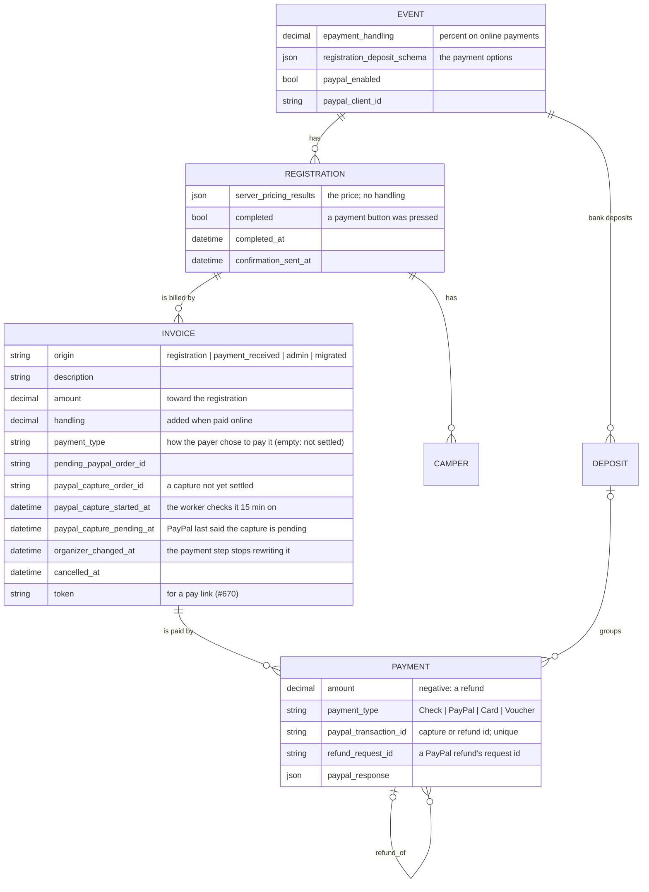

## 3. The ledger

```
total_owed = price total + Σ handling of invoices that aren't cancelled
total_paid = Σ live payments (refunds are negative)
balance    = total_owed − total_paid            (negative: a refund is due)
uninvoiced = balance − Σ amount_due of open invoices   (never below 0)
```

`invoices.ledgers()` works these out for many registrations in two queries; the registration
serializer adds them to `/api/registrations/`, and `templating/graph.py` gives templates the same
numbers.

A worked Lark example: two adults, price $1,000, of which tuition and meals are $1,000. Lark's
"50% Deposit" option comes to $500; the handling percent is 2.5%.

| Step | Invoices | total_owed | total_paid | balance | uninvoiced |
|---|---|---|---|---|---|
| They press **Pay $500 by check** | #1 "50% Deposit" $500, open | $1,000 | $0 | $1,000 | $500 |
| The registrar records the $500 check | #1 paid | $1,000 | $500 | $500 | $500 |
| A registrar invoices the balance (#670) | #2 "Registration balance" $500, open | $1,000 | $500 | $500 | $0 |
| They pay #2 online: $500 + $12.50 handling | #2 paid, handling $12.50 | $1,012.50 | $1,012.50 | $0 | $0 |

## 4. A registration's states

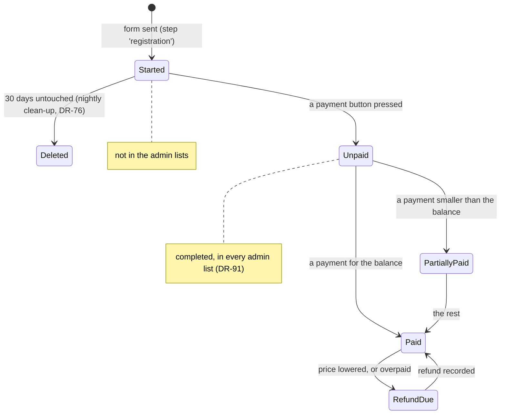

## 5. The registration flow

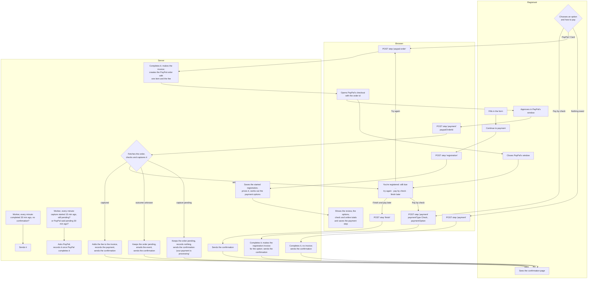

- The registration is **started** when the form is sent, and **completed** the moment a payment
  button is pressed (`RegisterView.complete`). It's in the admin lists from then on.
- The browser saves the payment step in localStorage, with the form data and promo code it was
  sent with (`pages/register/storage.ts`), so a reload — or coming back after closing PayPal's
  window — resumes paying for the same registration, still showing what was entered. Coming back
  to the form offers "Continue to payment" or "Start a new registration".
- **A saved registration the server no longer has (#769)** — an organizer deleted it, or it was
  purged as incomplete — gets 404 `registration_not_found` from every step after `registration`
  (`RegisterView.named_registration`), and nothing is changed or charged. The browser forgets
  the saved one and goes back to the form, keeping what was entered, and asks for it to be sent
  again (`pages/register/useForgetSentRegistration.ts`).
- While nothing is paid on the registration invoice, the registrant can change option or method;
  `prepare_registration_invoice` rewrites it in place (and does nothing on an identical repeat).
- **An organizer's change sticks (#766).** When a registrar or admin changes the registration
  invoice's amount, description or handling, or cancels or reopens it, `InvoiceViewSet` sets
  `organizer_changed_at`. From then on the payment step's one option is that invoice
  (`registration_payment_options`: `invoice:{id}`, for what it asks now), and
  `prepare_registration_invoice` only records the method (`payment_type`, clearing any pending
  order). The payment page asks for its payment step again when it opens (`payment-step`), so a
  page reopened later shows the organizer's amount; a page left open that posts an earlier
  option gets 409 `invoice_changed` with the fresh payment step, and shows that. A cancelled one
  is refused with 409 `cancelled`, so a stale tab can't reopen it. Memo, notes and due date don't
  count. The registration's own invoice can't be deleted (it would be made again), only
  cancelled.
- **Finish and pay later** (or the worker's half-hour confirmation) clears an unpaid PayPal or
  Card choice from the registration invoice first (`clear_unpaid_online_choice`, #759), so the
  confirmation doesn't say they chose to pay online. The pending PayPal order stays: it's what
  the admin list's "Online payment not finished" badge looks for, and what "Check PayPal order"
  checks. After a lost PayPal answer the confirmation has already gone out, so PayPal stays; and
  a choice whose capture PayPal is still processing isn't cleared: they did pay that way (#767).
- **Abuse (#801).** Anyone may post the steps, and a check payment emails a confirmation to the
  address the form gave, so anonymous posts are throttled per client address (scope `register`,
  `CAMPHORIC_REGISTER_RATE`, 10 a minute by default, counted per server process). A
  registration makes 3 or 4 counted posts; past the limit a step is a 429 asking the
  registrant to wait and try again. The PayPal or card capture isn't counted, so a payer's
  approval is never thrown away, and signed-in users (the event importer) aren't throttled
  (SPEC DR-125).

## 6. Paying online, step by step

```mermaid
sequenceDiagram
    actor R as Registrant
    participant B as Browser
    participant S as Server
    participant P as PayPal
    R->>B: Clicks PayPal (or Debit or Credit Card)
    B->>S: POST register {step: 'paypal-order', paymentOption, paymentType}
    S->>S: complete the registration, make the registration invoice
    S->>P: create order: amount due + fee, one item<br/>"Total for Invoice no. N for Event", custom_id invoice:N,<br/>payee_preferred IMMEDIATE_PAYMENT_REQUIRED
    P-->>S: order id
    S->>S: invoice.pending_paypal_order_id = order id
    S-->>B: {orderID, total, handling}
    B->>P: open checkout for the order
    R->>P: approves
    P-->>B: onApprove(orderID)
    B->>S: POST register {step: 'payment', paypalOrderId}
    S->>S: invoice.paypal_capture_order_id, _started_at = order id, now (committed)
    S->>P: GET the order
    alt already COMPLETED (a retry, or a lost reply)
        S->>S: as below, by the capture's status: return the payment,<br/>or record the missing one
    else APPROVED, for what the invoice asks now
        S->>P: capture (PayPal-Request-Id = order id)
        P-->>S: order COMPLETED, capture id and capture status
        alt capture COMPLETED
            S->>S: invoice.handling += fee, record the payment<br/>(paypal_transaction_id = capture id), commit
            S->>S: lock the registration again: send the confirmation
            S-->>B: confirmation page, invoice, ledger
        else capture PENDING
            S->>S: record nothing; keep the pending order,<br/>paypal_capture_pending_at = now, commit
            S->>S: send the confirmation
            S-->>B: 409 pending: "your payment is processing"
        else capture DECLINED or FAILED
            S-->>B: 402 declined (no money taken)
        end
    else the invoice changed since the order was made
        S-->>B: 409 amount_changed (nothing captured)
    else PayPal declines
        P-->>S: 422 INSTRUMENT_DECLINED
        S-->>B: 402 declined (nothing captured)
    else no clear answer (timeout, 5xx), or recording the capture failed
        S->>S: keep the pending order, email the event the details
        S->>S: send the confirmation
        S-->>B: 502 unknown: "please don't pay again"
    end
```

- **Why approve isn't enough.** Approval only means the payer agreed; the server's capture is
  where money moves, after the server has checked the order is this invoice's and for the amount
  it asks *now*. So a stale page, a tampered amount or an invoice edited meanwhile can't take the
  wrong amount (#675). The order id comes from the browser, so one that isn't PayPal's shape
  (`[A-Z0-9]{1,64}`) is refused as an unknown order (`mismatch`) before any call to PayPal (#818).
- **The capture commits on its own (#804).** The `payment` step, like the pay page, calls
  `capture_paypal_order` with no transaction open. It locks the registration, then the invoice
  (the order every payment step takes them in), and fetches, captures and records in one
  transaction that commits; for a lost answer, the PayPal problem email commits too. Only then
  does the step lock the registration again and send the confirmation and the reply, in a second
  transaction. An error there can't undo a payment PayPal has already taken; the registrant's
  confirmation then comes from the worker's half-hour sweep.
- **A capture that never got recorded (#804).** Before it asks PayPal, `capture_paypal_order`
  marks the invoice with the order it's capturing and when (`paypal_capture_order_id`,
  `paypal_capture_started_at`), committed at once, and clears the mark when the capture has an
  outcome: recorded, or refused by PayPal (no money moved). A lost answer, or a process that dies
  after PayPal takes the money and before the payment is recorded, leaves the mark. 15 minutes
  on, the worker's `reconcile` asks PayPal about the marked order
  (`invoices.check_unrecorded_captures`, with no rows locked while it waits) and records it if
  it was captured ("Recorded by the worker checking PayPal") — even if another order is pending
  on the invoice by then. A definite answer settles the mark: captured and recorded, not
  captured (the order stays pending: it still marks an online payment not finished, and "Check
  PayPal order" still settles it), unknown to PayPal (404), or not this invoice's. Anything else
  (PayPal down, rate-limited or refusing our credentials) is asked again each minute, for up to
  a day. Each run asks about at most 5, in no fixed order, and tells the worker's heartbeat it's
  still working after each, so slow PayPal calls can't make the reconciler look stuck. "Check
  PayPal order" settles the mark too when it records the order or finds it wasn't captured.
  Orders whose capture never started — the registrant closed PayPal's window — aren't asked
  about.
- **No new payment while a capture is unsettled.** While an invoice carries that mark (up to a
  day), a new PayPal order on it — from the payment step or the pay page — and the payment
  step's pay-by-check are refused with 409 `not_payable` ("still being confirmed … don't pay
  again"): PayPal may have the money, and a second order would also overwrite the mark. The
  worker normally settles it within about 16 minutes, or a registrar can with "Check PayPal
  order".
- **Why `paypal_transaction_id` is unique.** It's PayPal's capture id (or refund id). Fetching the
  order first means a retried call, a double click, a lost capture reply or "Check PayPal order"
  after a capture all find it already captured and return the existing payment — one PayPal
  transaction is never recorded twice. The `PayPal-Request-Id` header makes PayPal itself return
  its first answer to a retried create, capture or refund.
- **A pending capture isn't a payment (#767, SPEC DR-133).** PayPal's order says `COMPLETED`
  once it's captured, even when the capture itself is `PENDING` (PayPal's review, the payee's
  receiving settings) or `DECLINED`, so the server reads the capture's status
  (`invoices._capture_outcome`): `COMPLETED` — or `PARTIALLY_REFUNDED`/`REFUNDED`, money that
  arrived and has since gone back — is recorded; `PENDING` records nothing; anything else took no
  money. Orders are created with `application_context.payment_method.payee_preferred:
  IMMEDIATE_PAYMENT_REQUIRED`, so PayPal doesn't offer an eCheck or other funding that stays
  pending (it's set on the order rather than in `payment_source.paypal.experience_context`,
  which would tie the order to the PayPal wallet when the payer may use the Card, Venmo or Pay
  Later button); the capture's status is checked anyway.
- **While a capture is pending.** `_capture_pending` keeps the order as the invoice's pending
  order and keeps the capture's mark, adding `paypal_capture_pending_at`. The registrant is
  told their payment is processing and not to pay again (`pending`, 409; the payment step's
  `paymentProcessing` and the pay page's `processing` say so when the page is opened again), and
  gets their confirmation. Until the marks are cleared the invoice is **held**
  (`capture_processing`, however long it takes): it takes no other payment (`not_payable`,
  "PayPal is still processing a payment …"), the pay page offers no buttons, it can't be
  cancelled or deleted (409, `held_message`; the admin's invoice offers neither, and shows
  "PayPal is still processing a payment"), since the payment may yet be recorded on it. The
  worker asks PayPal again each time `paypal_capture_pending_at` is half an hour old
  (`PENDING_CAPTURE_ASK_EVERY`), for 30 days from the capture (`PENDING_CAPTURE_WATCHED_FOR`):
  still pending, it notes when it asked; completed, it records the payment ("Recorded by the
  worker checking PayPal") and clears the marks; declined, it emails the event (the PayPal
  problem email, `capture_denied`: the registrant was told it's processing, so someone should
  tell them it didn't go through) and clears the marks, so the invoice takes payments again, and
  leaves the order for "Check PayPal order" to clear. PayPal no longer finding the order (404),
  or finding it isn't this invoice's, is emailed (`capture_lost`) and settled the same way.
- **When the 30 days are up.** The sweep picks a pending capture only while it was last asked
  about within its watch (`paypal_capture_pending_at` before `paypal_capture_started_at` + 30
  days), so one still pending is asked about once more after the watch: it's reported
  (`capture_expired`), its `paypal_capture_pending_at` set to then, and it's asked about no more.
  When PayPal can't be asked then (it's down, or refuses our credentials), it's asked each run
  for up to a day past the watch, then reported the same way with that error.
  Its marks and order stay, so the invoice stays held (`capture_watch_lapsed`; the admin's
  `paypal_capture_lapsed` says it's no longer asked about): PayPal still has the payment and may
  yet complete it, and a payable invoice would get a new order in place of the old one, which
  "Check PayPal order" could then no longer find. A registrar settles it in PayPal and presses
  "Check PayPal order": it records the payment, clears the order, or — still pending — starts
  another 30 days (`_capture_pending` restarts `paypal_capture_started_at` once the watch has
  ended). The problem emails about a pending capture are deduplicated per order, kind and watch
  (`paypal_capture_started_at` is in the key), so each watch's end is reported.
- **"Check PayPal order" and repeats.** It answers `pending` while the capture is pending, and
  otherwise does what the worker does, without the email: an order PayPal no longer knows (404),
  or one that isn't this invoice's, answers `mismatch` (400) and settles the capture's marks
  (`PaymentProblem.not_this_order`), so a held invoice is released; its message then gives the
  registrar the `capture_lost` email's advice (record the payment by hand if PayPal took the
  money). Any other refusal (401, 403: the event's PayPal credentials) settles nothing; the fix
  is the event's PayPal settings, then another check. The worker's emails go only
  when its own write still matched the marks it read (`_capture_settled` and `_asked` say
  whether they did), so a check that settled the capture, or began another watch, while the
  worker was asking PayPal isn't followed by stale news. A repeated capture of an order PayPal
  is processing answers `pending` without asking PayPal. One that read the invoice before the
  first marked it pending gets past that first look, but its own first write
  (`paypal_capture_order_id`, `_started_at`) skips an invoice with `paypal_capture_pending_at`
  set, and it looks again once it holds the invoice's lock: it answers `pending` there too,
  before asking PayPal, and leaves the marks alone. The confirmation sweep doesn't wait for a
  pending capture, and doesn't clear the invoice's PayPal choice for one; templates see
  `invoice.payment_processing`, so the confirmation can say it's processing.
- **What isn't handled.** A capture PayPal completes and later reverses (a chargeback) isn't
  noticed: that needs PayPal's webhooks (`PAYMENT.CAPTURE.DENIED`, `.REVERSED`), which the
  server doesn't take.
- **The fee** isn't saved on the invoice until the capture, so an abandoned order adds nothing to
  what's owed.
- **PayPal or Card** is the button the payer pressed (`paymentType`), on the invoice and the
  payment. PayPal's own `payment_source` is a last resort: its card button can report a card
  payment as `paypal` (#758).
- **When PayPal's buttons can't load.** The buttons come from PayPal's script, loaded with the
  event's `paypal_client_id`. If PayPal refuses that id ("client-id not recognized" — e.g. an id
  from another PayPal account, or a sandbox id against live), a blocker stops the script, or
  PayPal is down, the payment step and the pay page say online payment isn't available instead
  of showing buttons (`PayPalCheckout`). Nothing reaches the server, so there's nothing to clean
  up; the fix is the event's client id (it must belong to the same PayPal app as the server's
  `PAYPAL_SECRET`, on the same sandbox or live `PAYPAL_BASE_URL`).
- **The PayPal problem email** (`invoices.send_paypal_problem_report`, kind `payment_report`) goes
  to the event's `confirmation_email_from`, once per order (and, for news of a pending capture —
  `capture_denied`, `capture_expired`, `capture_lost` — once per kind and watch): what happened, who (registration,
  registrant, campers, an admin link when `CAMPHORIC_PUBLIC_URL` is set), what for (invoice,
  amounts, payment type), PayPal's references and error, what the registrant was told, and what
  to do. Without an event address it's only logged (always at ERROR).
- **When recording fails after PayPal moved the money** (#767) — a database error or a bug while
  saving the capture or refund, or PayPal saying an order was already captured and then not
  answering what for — the half-done write is rolled back with its transaction and the failure is
  handled as an `unknown` outcome: the event gets the problem email (its error line says what
  failed), and the registrar or registrant is told (502). For a capture the registrant is asked
  not to pay again, and the order stays pending and marked, so the worker asks PayPal about it 15
  minutes on and records it (or "Check PayPal order" does). For a refund the registrar is asked
  to press "Refund through PayPal" again in the same dialog, which records it once (§11). The report is written after the
  rollback, with no transaction open, so it isn't lost with it.
- **"Check PayPal order"** on the invoice (`/api/invoices/{id}/check-paypal/`) locks the
  registration and then the invoice, the order every payment step takes them in (#819), and asks
  PayPal about the pending order: a capture PayPal completed is recorded (`recorded`); one it's still processing
  stays pending (`pending`; watched for another 30 days if its watch had ended); anything else — not captured, or a capture declined — is cleared
  (`not_captured`: no money was taken). An order PayPal doesn't know, or that isn't the
  invoice's, is a 400 `mismatch`, and any capture of it is settled.

## 7. Paying by check

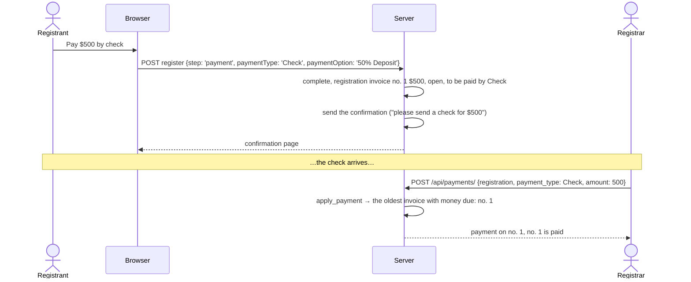

## 8. When the confirmation email goes out

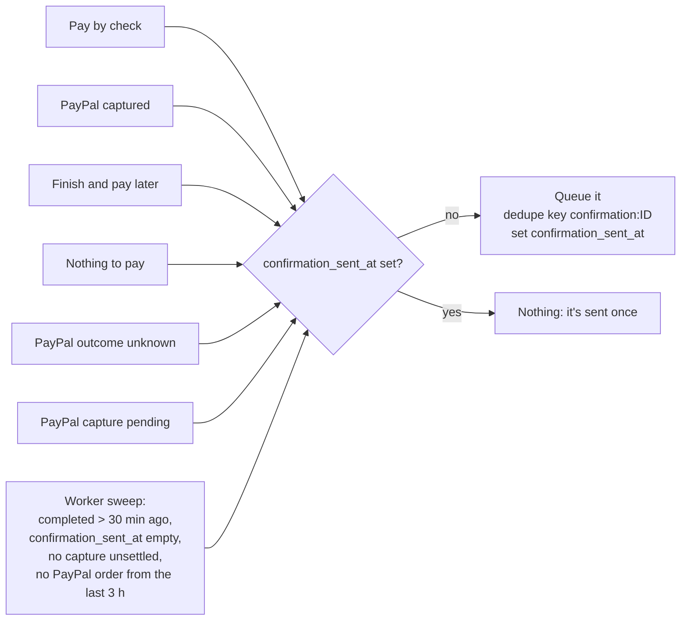

`confirmations.send_confirmation` does the sending; `confirmations.send_overdue_confirmations`
is the sweep, called from the worker's `reconcile` task — after `check_unrecorded_captures`
(§6). The sweep skips a registration while one of its invoices has a capture not yet settled
(for up to a day), so a confirmation sent late says what was paid — but not one PayPal says is
pending, which may take days (#767). Registrations converted by migration 0076
have `confirmation_sent_at` set, so the sweep never emails anyone from before.

It also passes over a registration whose invoice has a pending PayPal order made in the last
three hours (`PENDING_PAYPAL_ORDER_WINDOW`, #767): the payer may still be in PayPal's window, and
if they approved after an "unpaid" confirmation they'd be told the wrong thing. The invoice's
`updated_at` stands in for when the order was made (making it is the payment step's last save of
the invoice), so a later edit of the invoice holds the confirmation back a while longer. Someone
who pressed PayPal and walked away gets their confirmation about three hours on instead of thirty
minutes.

## 9. Recording a payment (admin)

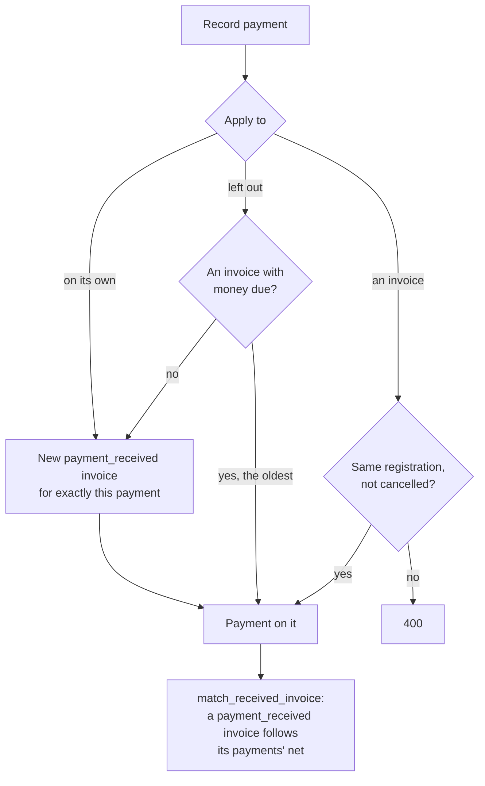

- Two checks on one invoice: a $500 deposit invoice gets a $450 check (partially paid, $50 due),
  then a $50 check (paid).
- `match_received_invoice` keeps a `payment_received` invoice honest: correct a $20 typo to $200
  and the invoice becomes $200 (not "overpaid by $180"); delete the payment (Admins only) and the
  invoice is cancelled (not "$200 due"); restore it and the invoice reopens.
- A payment saved any other way (Django admin, a shell) without an invoice gets one the same way
  (`Payment.save`).
- **Editing a payment can't contradict what already happened to it** (#767,
  `PaymentSerializer.validate_edit`): its amount can't go below what its refunds gave back, a
  refunded payment can't move to another invoice, and a refund can't be detached from or moved to
  another payment. A payment or refund PayPal recorded (it has a capture or refund id) keeps
  PayPal's amount and stays PayPal or Card (either may be corrected to the other, #758) — so the
  ledger agrees with PayPal and the payment stays refundable through it. Sending the same values
  back is fine; only a change is refused (400). A deleted refund can't be restored while its
  payment is deleted ("Restore its payment first"), nor if it would give back more than is left
  of its payment (409).
- **Checking what's left of a payment waits for a refund through PayPal** (#767). That refund
  holds the payment's row (`invoices.lock_payment`) while it asks PayPal and records the answer;
  recording a refund by hand, editing one, or restoring one takes the same row before checking
  what's left (after the refund's own row, when it's the one changing — the edit's version check
  takes that first), and an edit of the payment itself already holds it. So a $30 check refund
  entered while an $80 PayPal refund of a $100 payment is underway waits, then is refused,
  instead of both going through.

## 10. An invoice's lifecycle

```mermaid
stateDiagram-v2
    [*] --> Open
    Open --> PartiallyPaid: a payment less than due
    Open --> Paid: payments = total
    PartiallyPaid --> Paid: the rest
    Paid --> Overpaid: more paid than the total<br/>(or its amount lowered)
    Overpaid --> Paid: refund the difference
    Paid --> PartiallyPaid: a refund, or its amount raised
    Open --> Cancelled: cancel (it holds no money)
    Cancelled --> Open: reopen
    Paid --> Cancelled: cancel, once refunded to 0
    Open --> [*]: delete (Admins; nothing ever paid on it)
```

Status is never stored: `Invoice.status` (and `templating/graph.invoice_status`) work it out from
`cancelled_at`, the total and the live payments' net.

**Neither cancelled nor deleted while PayPal may pay it (#767).** An invoice whose capture hasn't
settled (`invoices.capture_unsettled`: a capture under way, or one PayPal is processing, §6) is
refused a cancel or a delete with a 409 saying why (`held_message`): the worker or "Check PayPal
order" may still record PayPal's payment on it, which would land on a cancelled invoice, or be
lost with a deleted one. The cancel looks with the invoice's row locked; the delete's plan
(`deletes.invoice_has_no_paypal_payment_underway`) blocks it in the preview, and looks again with
the row locked inside the delete, for a capture that started since.

**An edit made from a stale invoice is refused (#770).** Every invoice counts its saves in
`version`, and the payment step's rewrites count too. An organizer's edit, cancel or reopen sends
the version the dialog opened at as `If-Match`; if anything saved the invoice since (another
registrar, or the registrant's payment step), `InvoiceViewSet` answers 412 with the invoice as it
is now, under the same row lock as DR-105, and nothing changes. The edit dialog then shows both
sides' changes and asks whether to save the organizer's on top or drop them (SPEC §9.8, DR-109).

## 11. Refunds

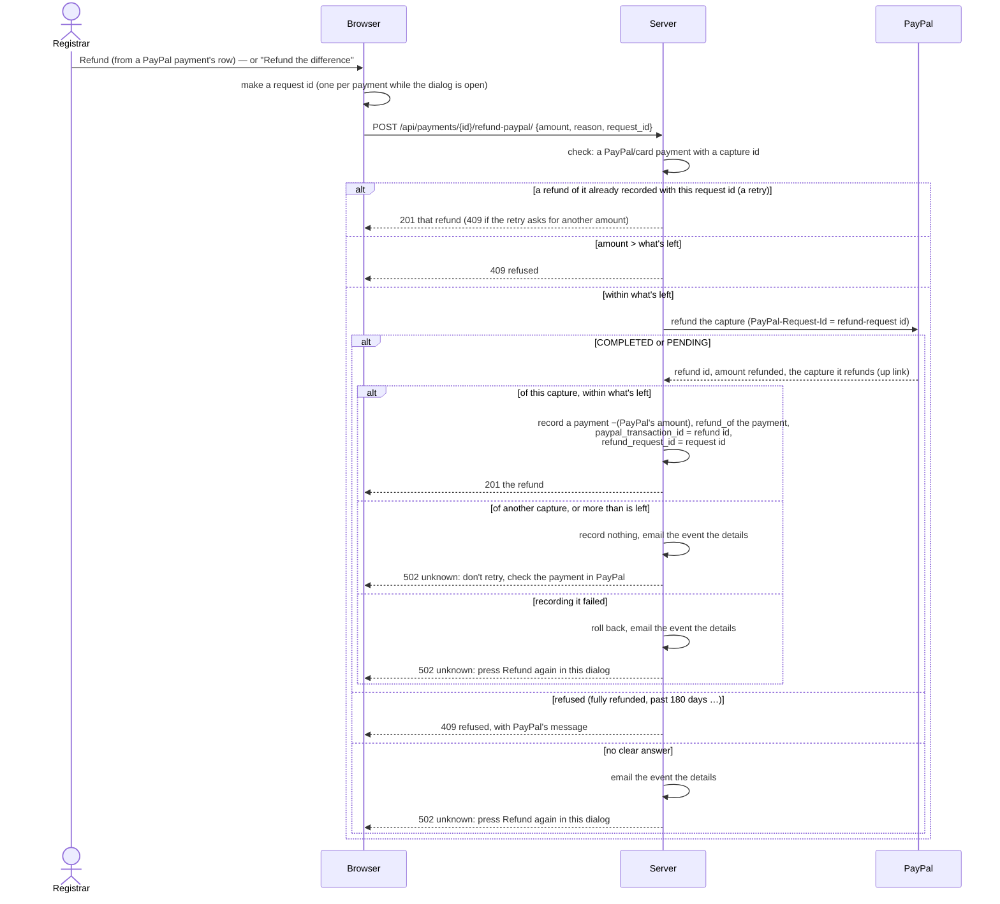

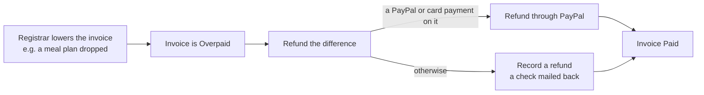

- **A retried refund gets the one already recorded (#817).** The refund keeps the attempt's
  `request_id` (`refund_request_id`, read-only in the API), and a retry with it — a timeout, a
  double click — gets that refund back before the amount is checked, so retrying a full refund
  isn't refused for having nothing left. A retry asking for a different amount is refused (409),
  since that refund didn't give it back. A refund recorded before that field existed has no
  request id: a retry of it is found by PayPal's refund id (`PayPal-Request-Id` makes PayPal
  return its first refund) only if its amount still fits in what's left, so retrying such a
  full refund is still refused.
- A check mailed back is recorded by hand: a negative payment with `refund_of`.
- **The amount recorded is PayPal's** (#767). While it's open, the dialog keeps one request id
  for each payment it refunds from, even if the amount is changed, so a retry can't refund a
  second time; switching to another payment of the invoice uses another id, since PayPal would
  answer the first payment's id with the first payment's refund. A retry of a refund already
  recorded is answered from the ledger (above: the same refund, or 409 for another amount). One
  whose first reply was lost, so nothing was recorded, reaches PayPal, which answers a request
  id it has seen with that first refund whatever amount the retry asks for — so the refund is
  recorded for the amount in PayPal's reply, with the request id, and a further retry for
  another amount is then refused.
- **A reply that can't be this payment's refund isn't recorded** (#767, `record_refund`): one
  whose `up` link names another capture, or whose amount is more than is left of the payment
  (say a $25 refund was recorded by hand after the reply was lost, and PayPal's earlier refund
  no longer fits). The money moved, so it's an `unknown` outcome: the event gets the problem
  email with PayPal's refund id and amount, and someone checks PayPal. Its email and the
  registrar's message say not to retry (PayPal answers the same request the same way) but to put
  the ledger right and record it by hand. It's emailed even when an earlier problem with the same
  request id was (its dedupe key adds `:doesnt-fit`), since that email said a retry would
  record it.
- **When a refund couldn't be recorded, or PayPal's answer was lost, try again from the same
  dialog.** The retry sends the same request id, so PayPal returns the same refund rather than
  refunding again (or makes it, if it never did), and it's recorded once. Recording it by hand
  instead would leave a refund with no request id, and a retry from the still-open dialog would
  then record PayPal's refund a second time. The registrar's 502 message says to press Refund
  again in the dialog; the problem email asks the event to have whoever made the refund do that,
  and to record it by hand only if that dialog was closed.
- Refunding doesn't change the handling fee: if the organizers' policy is to return the fee,
  the registrar edits the invoice's handling too.
- A converted PayPal payment whose verification had failed back then has no capture id, so it
  can only be refunded in PayPal's dashboard and then recorded here.

## 12. The handling fee, and who can do what

- The fee is `pricing.handling_fee(amount, percent)`: the percent of the amount, in cents, a
  half cent up (2.5% of $7 is $0.175 → $0.18). The client's `pricing/handlingFee.ts` is the same
  function, kept in step by `pricing/test/handlingFee.fixtures.ts` and `TestHandlingFeeRounding`.
- It's added when an invoice is captured online, on what the invoice still asked
  (`online_fee`). An invoice that already has a fee gets none added. Paying by check adds none.
- Registrars change it on the invoice; "Calculate" suggests `handlingFee(amount − paid, percent)`.

| | Admin | Registrar | Reporter |
|---|---|---|---|
| See invoices, payments, notes | ✓ | ✓ | ✓ |
| Record a payment | ✓ | ✓ | |
| Edit an invoice (amount, handling, memo, notes, due date) | ✓ | ✓ | |
| Cancel / reopen an invoice | ✓ | ✓ | |
| Check a PayPal order | ✓ | ✓ | |
| Refund (through PayPal or recorded) | ✓ | ✓ | |
| Restore a deleted payment | ✓ | ✓ | |
| Make an invoice, or invoice the balance | ✓ | ✓ | |
| Send an invoice (the invoice email) | ✓ | ✓ | |
| Copy an invoice's pay link | ✓ | ✓ | ✓ |
| Delete a payment | ✓ | | |
| Delete an invoice (nothing ever paid on it) | ✓ | | |

## 13. Templates

- `registration.invoices`, `registration.invoice` (the registration invoice) and the `invoice`
  root of the confirmation email and page; `invoices` in reports; `payment.invoice`,
  `payment.is_refund`, `payment.refund_of`, `payment.paypal_response`.
- `registration.total_owed` includes the handling fees; `total_paid` is net of refunds;
  `balance` can be negative.
- For older templates, these are still there, worked out from the registration invoice:
  `registration.payment_type` (its payment type), `initial_payment` (`type` = its description,
  `total` = its total, `balance` = `total_owed − total`) and `registration.paypal_response` (its
  PayPal payment's record). `pricing.handling` is gone.
- `invoice.pay_url` is the invoice's public pay page (§15). The `invoice_email` context — the
  event's invoice email — has `event`, `invoice`, `registration` and `campers`. A confirmation
  email can link to `registration.invoice.pay_url` when something is still due.
- Confirmation templates must read well when nothing is paid yet: a check to send, or an online
  payment that didn't go through (`invoice.amount_due`, `invoice.payment_type`). When such a
  registrant finishes to pay later, or gets the worker's half-hour confirmation, the payment type
  is cleared (`None`): guard it with ``.

## 14. Code map

**Server** (`server/camphoric/`)
- `invoices.py` — the ledger (`ledgers`, `ledger`), `invoice_for_payment`,
  `match_received_invoice`, `refundable`, payment options (`payment_options`, `find_option`),
  the registration invoice (`prepare_registration_invoice`), PayPal (`create_paypal_order`,
  `capture_paypal_order`, `record_capture`, `check_paypal_order`, `check_unrecorded_captures`,
  `capture_processing`, `capture_unsettled`, `capture_watch_lapsed`, `refund_paypal_payment`)
  and the problem email.
- `deletes.py` — `invoice_has_no_payments` and `invoice_has_no_paypal_payment_underway`, the
  rules for deleting an invoice.
- `paypal.py` — `PayPalClient`: fetch, create, capture, refund; `PayPalError(unknown=…)`;
  `checked_order_id`.
- `confirmations.py` — sending the confirmation, problem reports, the overdue sweep.
- `worker.py` — `reconcile`, the every-minute task that runs both sweeps.
- `views.py` — `RegisterView` (the `registration`, `paypal-order`, `payment` and `finish` steps),
  `InvoiceViewSet` (with `send`), `RegistrationViewSet.invoice_balance`, `PaymentViewSet` (with
  `refund-paypal`), and `InvoicePayView`, the public pay page's API.
- `serializers.py` — `InvoiceSerializer`, `PaymentSerializer`, the registration's ledger fields.
- `models.py` — `Invoice`, `Payment` (`invoice`, `refund_of`, `paypal_transaction_id`,
  `refund_request_id`), the registration's `completed_at` and `confirmation_sent_at`.
- `templating/graph.py`, `templating/registry.py` — the template variables;
  `templating/emails.py` `render_invoice_email` and `templating/urls.py` `invoice_pay_url`.
- `migrations/0075`–`0077` — the schema, the conversion, and the clean-up; `0078` — the invoice
  email template; `0084` — the invoice's `paypal_capture_order_id` and
  `paypal_capture_started_at`; `0085` — the payment's `refund_request_id`.

**Client** (`client/src/`)
- `pages/register/payment/PaymentNeeded.tsx` — the payment step;
  `PaymentOptions/`, `PaymentNotFinished.tsx`, `components/PayPalCheckout/`.
- `pages/register/storage.ts` — the saved payment step.
- `store/registrationApi.ts` — the register steps, `paymentProblem` and `registrationNotFound`.
- `pages/admin/registrations/invoices/` — the admin's ledger, invoices, payments and refunds;
  `store/invoices.ts` — their actions; `NewInvoiceModal.tsx` — making an invoice.
- `pages/invoice/` — the public pay page (`InvoicePayPage`, `InvoiceSummary`);
  `store/invoicePay.ts` — its API.
- `store/augmented.ts` — the server's ledger under the older report names.

## 15. Invoicing later, and the public pay page (#670, #623)

A registration can owe more after it registers: the rest after a deposit, a meal plan added
later, or a check that never came. A registrar makes an **invoice** for it and sends the payer its
**pay link**; the payer opens the link and pays online. The same page lets a check registrant
switch to PayPal after all — the fee is added only then (#623). Spec: §8.3, §8.4, §9.7, DR-95 and
DR-96.

### Making and sending an invoice

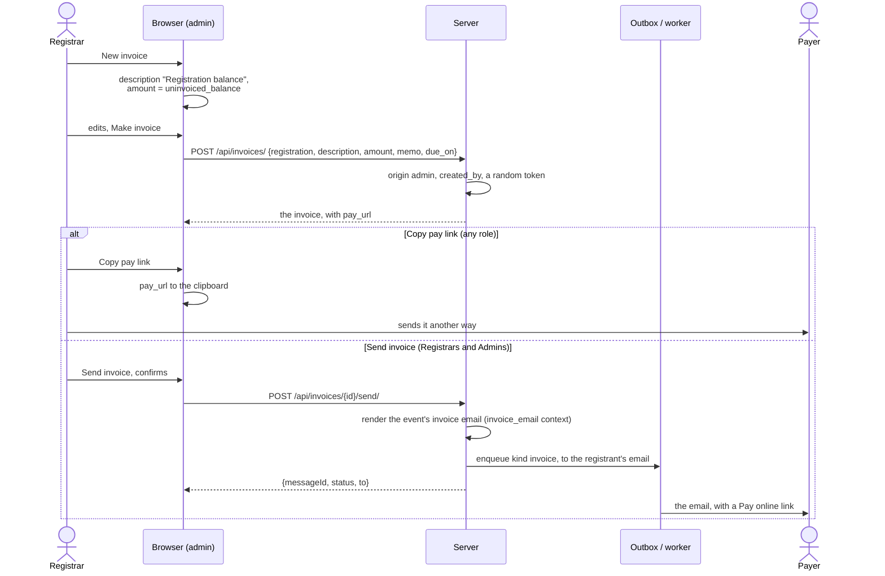

- **What it asks for.** An `admin` invoice is an ordinary bill: its `amount` adds to what the
  open invoices ask, and its status follows its payments like any other. "New invoice" starts
  with the registration's `uninvoiced_balance` — what no open invoice asks for yet — so
  invoicing the balance never asks twice for the same money. `POST
  /api/registrations/{id}/invoice-balance/` does the same in one call (409 when there's nothing
  left to invoice).
- **The invoice email** is an email template that comes with the event (`Event.invoice_template`,
  purpose `invoice`, made by migration 0078 for existing events), edited on Home beside the
  confirmation email. Its `invoice_email` context has `event`, `invoice` (with `pay_url`),
  `registration` and `campers`. The default shows the memo, the campers' first names, the
  description, amount due and due date, and `[Pay online]({{ invoice.pay_url }})`. A template
  that can't render sends nothing (400 with its diagnostics); a cancelled invoice can't be sent
  (409). The email shows in the registration's email history, kind "Invoice".
- **The link.** Every invoice gets `token = secrets.token_urlsafe(24)` when it's made — 32
  characters nobody can guess. `pay_url` is `{CAMPHORIC_PUBLIC_URL}/invoices/{token}`, or the
  request's host when that isn't set (port 8000 swapped for the dev server's 3000). The token
  itself is never in the admin API; `pay_url` is.

### Paying through the link

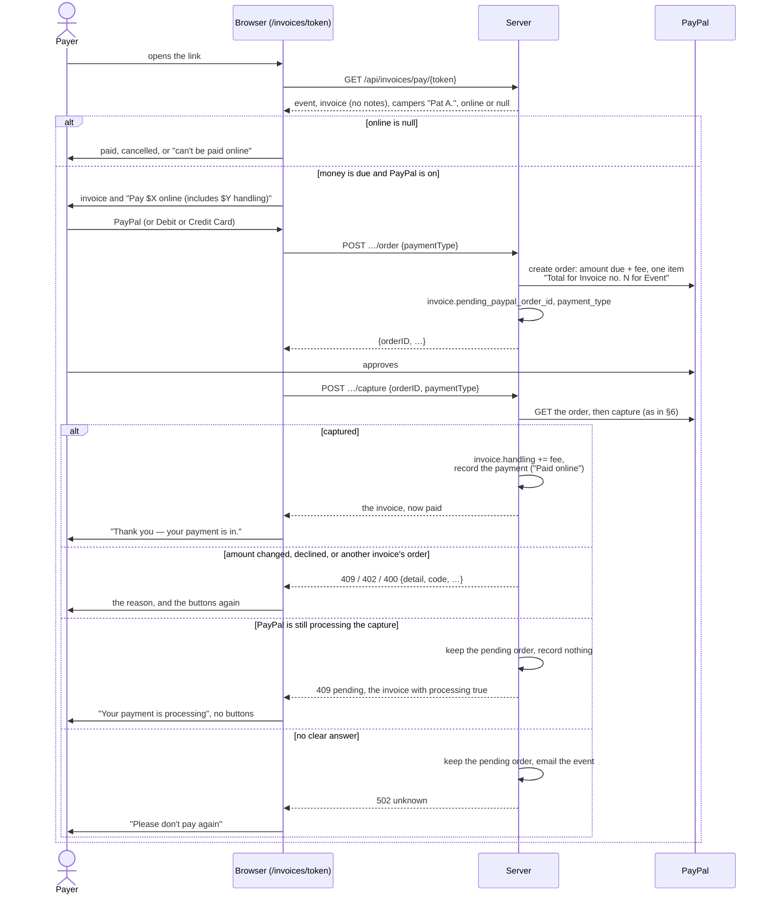

- **The same machinery as registration.** `InvoicePayView` calls `create_paypal_order` and
  `capture_paypal_order` (§6), so the checks, the single item, `paypal_transaction_id`, the
  PayPal problem email and "Check PayPal order" all work the same. Only the token decides which
  invoice; the order's `custom_id` must match it, or the capture is a `mismatch`.
- **Check first, PayPal later (#623).** A `registration` invoice the registrant chose to pay by
  check has `handling` 0. Paying it here adds `online_fee` on what's still due, at the capture —
  never before, so an abandoned order still adds nothing. An invoice that already carries a fee
  gets none added.
- **What the page shows**, and doesn't (DR-95). The link may be forwarded, so: the event's name;
  the invoice's number, description, memo, due date, amount, handling, paid and due, and status;
  the campers as first name and last initial. Never the invoice's notes, the registrant's email
  or the rest of the registration. A token of an incomplete registration's invoice is a 404, like
  an unknown one.
- **Abuse.** The endpoints are open to anyone, so they're throttled per client (scope
  `invoice_pay`, `CAMPHORIC_INVOICE_PAY_RATE`, 60 a minute by default). Guessing a 32-character
  random token isn't practical, and the throttle keeps anyone from trying wholesale.
- **A pending order.** When an order on the invoice hasn't been confirmed (`pending`), the page
  asks the payer not to pay again; a registrar settles it with "Check PayPal order".
- **A payment PayPal is still processing** (`processing`, #767). The page says so, and `online`
  is null, so it offers no buttons until the worker, or a registrar's "Check PayPal order", finds
  PayPal has completed (or declined) it.
